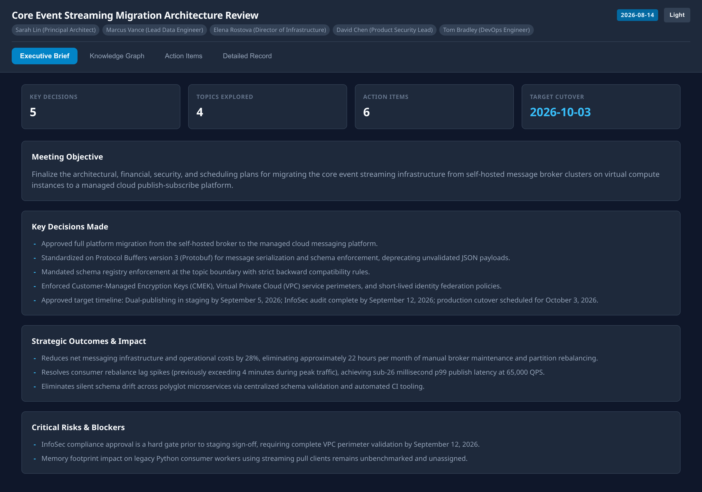
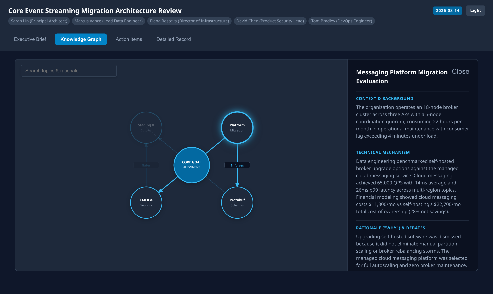
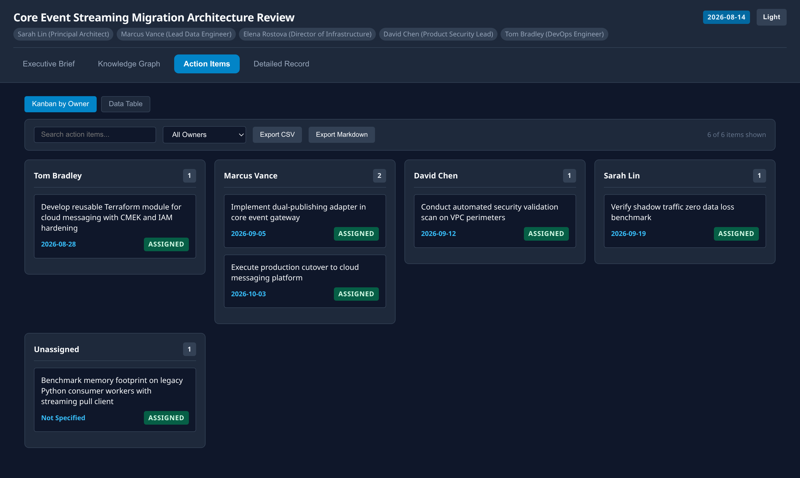

# Meeting and Presentation Transcript Summary Skill

A standardized agent skill for extracting concise, high-signal, grounded summaries and interactive visual dashboards from raw meeting or presentation transcripts. Compatible with agent platforms, assistant environments, and standalone LLM agent harnesses.

---

## Overview

Generic transcript summaries often either lose critical technical metrics and decisions OR expand into book-length play-by-play narration (*"David said... Sarah noted..."*) longer than the transcript itself. Furthermore, collaborative meetings and single-speaker presentations require distinct summary structures.

This single unified skill (`meeting-transcript-summary`) is designed for **immediate, single-turn execution**: you can simply invoke the skill and paste (or attach) a transcript to run immediately without answering follow-up questions. It uses three default settings that can be explicitly overridden in your prompt:

| Parameter | Default Value | Default Behavior (When Omitted) | How to Explicitly Override in Your Prompt |
| :--- | :--- | :--- | :--- |
| **1. Processing Mode** | **`meeting`** (`Meeting Mode`) | Runs **Meeting Mode** (3-section summary) by default. | Explicitly set the mode to presentation in your prompt (e.g., `"presentation mode"`, `"mode: presentation"`, `"in presentation mode"`). |
| **2. Interactive UI Dashboard** | **`no dashboard`** (Summary only) | Outputs the Markdown summary only; does **not** build `dashboard.html`. | Explicitly request a dashboard in your prompt (e.g., `"yes dashboard"`, `"build dashboard"`, `"create dashboard"`, `"with dashboard"`). |
| **3. Target User Name** | **`none`** (Omitted) | Generates the standard 3-section Meeting Mode output (omits Section 4). | Explicitly specify a participant name in Meeting Mode (e.g., `"for user Marcus Vance"`, `"for Marcus"`, `"user: Sarah Lin"`). |

### Mode 1: Meeting Mode (`meeting mode` - Default)
Used by default whenever Presentation Mode is not explicitly specified in the prompt. Designed for collaborative meetings with back-and-forth dialogue among participants. Produces a crisp, scannable three-part core deliverable (plus a fourth user-specific section when a user name is provided) and an optional 4-tab Meeting Dashboard (when explicitly requested):
1. **Executive Summary (`~70–130 words`):** High-level briefing scannable in <30 seconds—1-sentence objective plus tight 1-line bullets for key decisions, quantified outcomes, and critical blockers.
2. **Detailed Discussion Record and Action Items:** High-density, bullet-first record organized by logical topic (`Key Points`, conditional `Trade-offs & Rationale`, and 1-line `Decision / Status`). Preserves every concrete metric, spec, and trade-off without *"he said / she said"* narration or external explanations, followed by a concise 4-column Action Items table.
3. **Five-Sentence Summary:** Strictly five crisp, complete sentences (`≤ 18–20 words/sentence`) summarizing key decisions, impact, and timeline.
4. **Action Items for [User Name] (Optional - Default: `none`; Included Only When User Name Is Specified):** A tight brief paragraph (`≤ 75 words`) placed after the Five-Sentence Summary combining the specific action items assigned to a given user with concrete deliverables and deadlines. Omitted when no user name is specified.
5. **Interactive Meeting Web Dashboard (Optional - Default: `no dashboard`; Built Only When Explicitly Requested):** A 4-tab visual interface (`Executive Brief`, `Knowledge Graph`, `Action Items` Kanban/Table, and `Detailed Record`) emitted as `dashboard.html` when requested via `"yes dashboard"` or `"build dashboard"`.

### Mode 2: Presentation Mode (`presentation mode` - Explicit Override Only)
Activated **only** when `"presentation mode"` (or equivalent) is explicitly set in the prompt. Designed for presentations, keynotes, lectures, webinars, or demonstrations where one or more presenters speak sequentially (often walking through slides) without back-and-forth meeting debate:
1. **Chronological Presentation Summary Only:** Outputs the presentation header (`Title`, `Date`, `Presenter(s)`) followed strictly by a numbered, start-to-finish **Chronological Bullet Summary** (`1. [Segment Title]`, `2. [Segment Title]`, ...) with 3–5 fact-dense bullets per segment and inline slide references—zero *"presenter explained/noted"* narration.
2. **Strict Omission of Meeting Sections:** Explicitly omits the Executive Summary, Action Items table, Five-Sentence Summary, and User-Specific Action Items section.
3. **Presentation Knowledge Graph Web Dashboard (Optional - Default: `no dashboard`; Built Only When Explicitly Requested):** Opens **directly to the Interactive Presentation Knowledge Graph** (visualizing the central presentation theme, chronological progression `#1` through `#N`, conceptual links across slides/segments, and a slide-out Segment Inspector drawer) paired with a `Chronological Walkthrough` timeline tab.

Both modes operate under strict anti-bloat and grounding rules: strictly shorter than the source transcript, zero *"he said / she said"* narration, zero hallucination, and zero external topic explanations.


---

## Repository Structure

```text
meeting-transcript-summary-skill/
├── SKILL.md                                        # Primary agent instruction file supporting Meeting & Presentation modes
├── prd.md                                          # Product Requirements Document (PRD)
├── README.md                                       # End-user documentation and integration guides
├── LICENSE                                         # Apache 2.0 License
├── assets/
│   ├── skill_workflow_diagram.png                  # Architecture and workflow diagram
│   ├── user_interaction_diagram.png                # Execution parameters & user-specific Section 4 flow diagram
│   ├── dashboard_executive_brief.png               # Executive Brief screenshot (Meeting Mode)
│   ├── dashboard_knowledge_graph.png               # Topic Knowledge Graph screenshot (Meeting Mode)
│   ├── dashboard_action_items.png                  # Action Items Kanban screenshot (Meeting Mode)
│   └── dashboard_presentation_knowledge_graph.png  # Presentation Knowledge Graph screenshot (Presentation Mode)
├── templates/
│   ├── meeting_dashboard_template.html             # 4-tab interactive dashboard template for Meeting Mode
│   └── presentation_dashboard_template.html        # Knowledge Graph-focused dashboard template for Presentation Mode
├── references/
│   ├── dashboard_ui_guide.md                       # Guide for Meeting & Presentation interactive dashboards and data schemas
│   ├── transcript_formats.md                       # Reference guide for caption and transcript formats
│   └── quality_checklist.md                        # Verification rubric used to audit output quality across both modes
├── examples/
│   ├── sample_meeting_transcript.txt               # Sample meeting transcript (Meeting Mode, synthetic data)
│   ├── sample_output_summary.md                    # Expected output for Meeting Mode (including optional Section 4)
│   ├── sample_meeting_dashboard.html               # Working interactive dashboard example for Meeting Mode
│   ├── sample_presentation_transcript.txt          # Sample presentation transcript (Presentation Mode, synthetic data)
│   ├── sample_presentation_summary.md              # Expected chronological output for Presentation Mode
│   └── sample_presentation_dashboard.html          # Working Knowledge Graph dashboard example for Presentation Mode
└── scripts/
    └── clean_transcript.py                         # Standalone Python utility to strip caption timestamps
```

---

## Non-Technical User Guide: How to Use This Skill

You do not need any programming experience to use this skill. Simply invoke the skill and paste or attach your transcript-it runs immediately in a single step using sensible defaults.

### Step 1: Obtain Your Transcript

Export or copy the text transcript from your video call recording, webinar platform, or transcription tool. The skill accepts:
- Plain text copied and pasted directly into the chat window
- Attached text files (`.txt`)
- Exported subtitle or caption files (`.vtt` or `.srt`)

### Step 2: Invoke the Skill and Paste Your Transcript (With Optional Overrides)

When you invoke the skill with a transcript, the assistant immediately applies **three default settings** unless you explicitly override them in your prompt:
1. **Processing Mode (Default: `meeting`):** Runs **Meeting Mode** by default. It only switches to **Presentation Mode** when you explicitly include `"presentation mode"` in your prompt.
2. **Interactive UI Dashboard (Default: `no dashboard`):** Generates the Markdown summary only by default. It only builds the interactive `dashboard.html` when you explicitly add a request such as `"yes dashboard"` or `"build dashboard"` to your prompt.
3. **Target User Name (Default: `none` - Meeting Mode Only):** Generates the standard 3-section summary by default. If you explicitly include a participant's name (for example, `"for user Marcus Vance"` or `"for Marcus"`), the assistant adds a **fourth section (`## 4. Action Items for [User Name]`)** after the 5-sentence summary with a brief paragraph combining the action items assigned to that user and a concise description of what needs to be done.


#### Option A: Just Invoke the Skill and Paste the Transcript (Default Zero-Flag Execution)
To get a standard 3-section Meeting Mode summary with no HTML dashboard, simply invoke the skill and paste (or attach) the transcript-no flags or follow-up replies needed:

- **Example 1 - Pasting Transcript Only (Defaults: `mode = meeting`, `dashboard = no dashboard`, `user = none`):**
  ```text
  Use the meeting-transcript-summary skill on this transcript:

  Sarah Lin (10:01 AM): Let's finalize our Q4 database migration schedule.
  Marcus Vance (10:02 AM): Staging tests completed with zero data loss. I can run the production cutover on October 3.
  Sarah Lin (10:03 AM): Approved. Marcus, please publish the cutover runbook by Friday.
  ```
  **Result:** Executes immediately in one turn using **Meeting Mode**, generating the 3-part Markdown summary (`1. Executive Summary`, `2. Detailed Discussion Record and Action Items`, and `3. Five-Sentence Summary`) with no Section 4 and no HTML dashboard.

---

#### Option B: Add Explicit Overrides to Your Prompt (Dashboard, Presentation Mode, or Target User Name)

Whenever you want to build the interactive `dashboard.html`, include user-specific action items (Section 4), or switch to Presentation Mode, simply add the corresponding phrase to your prompt:

- **Example 2 - Requesting the Interactive Dashboard (`"yes dashboard"` or `"build dashboard"`):**
  ```text
  Use the meeting-transcript-summary skill on the attached transcript, build dashboard.
  ```
  **Result:** Runs **Meeting Mode** (default), outputs Sections 1-3, and builds the 4-tab interactive `dashboard.html` artifact upon completion.

- **Example 3 - Requesting User-Specific Action Items (`"for user Marcus Vance"`, Default No Dashboard):**
  ```text
  Use the meeting-transcript-summary skill on the attached transcript for user Marcus Vance.
  ```
  **Result:** Runs **Meeting Mode** (default), outputs Sections 1-3 **plus** `## 4. Action Items for Marcus Vance` (a brief paragraph detailing what Marcus Vance needs to do), and skips the HTML dashboard (`no dashboard` default).

- **Example 4 - Requesting Both the Dashboard and User-Specific Action Items (`"yes dashboard, for user Marcus Vance"`):**
  ```text
  Use the meeting-transcript-summary skill on the attached transcript, yes dashboard, for user Marcus Vance.
  ```
  **Result:** Runs **Meeting Mode** (default), outputs all 4 sections (including `## 4. Action Items for Marcus Vance`), and emits `dashboard.html`.

- **Example 5 - Switching to Presentation Mode (`"presentation mode"`, Default No Dashboard):**
  ```text
  Use the meeting-transcript-summary skill in presentation mode on the following transcript:

  [Paste presentation transcript here]
  ```
  **Result:** Switches to **Presentation Mode** and generates only the start-to-finish chronological walkthrough of what the presenter said (no Executive Summary, no Action Items table, no 5-Sentence Summary, no Section 4, and no HTML dashboard).

- **Example 6 - Switching to Presentation Mode + Building the Presentation Dashboard (`"presentation mode, build dashboard"`):**
  ```text
  Use the meeting-transcript-summary skill in presentation mode, build dashboard, on the attached transcript.
  ```
  **Result:** Switches to **Presentation Mode**, outputs the chronological summary, and emits the Presentation Knowledge Graph `dashboard.html` artifact upon completion.

- **Example 7 - Requesting Dual Output (Rendered + Raw Markdown) with User Name:**
  ```text
  Use the meeting-transcript-summary skill on the attached transcript for user Elena Rostova. Provide dual output with both rendered markdown and a raw markdown code block.
  ```

### Step 3: Use or Share the Output

- **Copying into Word Processors, Docs, or Email:** Highlight and copy the rendered summary directly from the chat window. Headings, bullet lists, and tables retain their formatting when pasted.
- **Copying into Wikis or Markdown Files:** Request `"raw markdown"` or `"dual output"` and click the copy button on the code block.
- **Exploring the Interactive Dashboard:** When you explicitly request a dashboard (`"yes dashboard"` or `"build dashboard"`), the assistant opens an interactive `dashboard.html` panel upon completion where you can click nodes on the Knowledge Graph, inspect slide or topic details, filter tasks by owner, or toggle between dark and light themes.

---

## Platform Deployment and Integration

### 1. Workspace Skill Integration

To register this skill in a local or shared workspace:

1. Copy the skill directory into your environment's skills path (for example, `.agents/skills/meeting-transcript-summary/` relative to the workspace root).
2. Invoke the skill in chat by pasting or referencing a transcript (with optional overrides as needed):
   ```text
   # Default execution (Meeting Mode, 3 sections, no UI dashboard)
   Use the meeting-transcript-summary skill on examples/sample_meeting_transcript.txt

   # With interactive UI dashboard and Section 4 for Marcus Vance
   Use the meeting-transcript-summary skill on examples/sample_meeting_transcript.txt, build dashboard, for user Marcus Vance

   # Presentation Mode (chronological summary only, no UI dashboard)
   Use the meeting-transcript-summary skill in presentation mode on examples/sample_presentation_transcript.txt
   ```

### 2. Assistant Configuration Interface

To configure this skill in a web-based assistant environment:

1. Open the skills or custom instructions configuration panel.
2. Create a skill named `meeting-transcript-summary`.
3. Copy the contents of [SKILL.md](SKILL.md) into the instruction body.
4. Optionally attach [references/transcript_formats.md](references/transcript_formats.md), [references/dashboard_ui_guide.md](references/dashboard_ui_guide.md), and [references/quality_checklist.md](references/quality_checklist.md) as reference documents.

### 3. Command Line Preprocessing and Agent Harness CLI Usage

Use the included Python script to strip WebVTT or SRT timestamps before passing a transcript to an automated CLI agent runner. Because the skill defaults to `meeting` mode, `no dashboard`, and `user = none`, it runs non-interactively in a single turn with zero flags required:

```bash
# 1. Normalize raw WebVTT or SRT files into consolidated speaker blocks
python3 scripts/clean_transcript.py raw_recording.vtt --output cleaned_transcript.txt

# 2A. Default Execution: Meeting Mode (3 sections, no UI dashboard, no user name)
cat cleaned_transcript.txt | agent-cli --prompt "Execute meeting-transcript-summary"

# 2B. Meeting Mode + Optional User Name (4 sections including Section 4 for Marcus Vance, no UI dashboard)
cat cleaned_transcript.txt | agent-cli --prompt "Execute meeting-transcript-summary for user Marcus Vance"

# 2C. Meeting Mode + UI Dashboard + Optional User Name (4 sections + emits dashboard.html)
cat cleaned_transcript.txt | agent-cli --prompt "Execute meeting-transcript-summary, build dashboard, for user Marcus Vance"

# 2D. Presentation Mode Override (chronological summary only, no UI dashboard)
cat cleaned_transcript.txt | agent-cli --prompt "Execute meeting-transcript-summary in presentation mode"

# 2E. Presentation Mode Override + UI Dashboard (chronological summary + emits dashboard.html)
cat cleaned_transcript.txt | agent-cli --prompt "Execute meeting-transcript-summary in presentation mode, yes dashboard"
```

---

## Detailed Output Specifications

### Mode 1: Meeting Mode (`meeting mode`)

#### 1. Executive Summary (`~70–130 words`, Scannable in <30s)
- **Meeting Objective:** 1 direct sentence (`≤ 25 words`) defining the primary goal.
- **Key Decisions Made:** Max 3–5 crisp 1-line bullets (`≤ 18 words/bullet`) of approved choices.
- **Strategic Outcomes and Impact:** Max 2–4 crisp 1-line bullets (`≤ 18 words/bullet`) citing explicit metrics, savings, or operational impacts.
- **Critical Risks and Blockers:** Max 2–4 crisp 1-line bullets (`≤ 18 words/bullet`) of unresolved dependencies or gates (`None stated` if none).

#### 2. Detailed Discussion Record and Action Items
- **Logical Topic Organization:** Groups dialogue by subject matter rather than chronological turns.
- **Key Points (Bullet-First, Fact-First):** 2–5 tight factual bullets per topic (`≤ 22 words/bullet`) preserving every spec, benchmark, number, and constraint—zero *"he said / she said"* narration or external explanations.
- **Trade-offs & Rationale (Conditional):** Included only when alternatives were actually weighed or debated (1–3 crisp bullets or 1 tight line explaining why Option A beat Option B).
- **Decision / Status:** 1 crisp line (`≤ 18 words`) stating the final agreement or open status.
- **Action Items Table:** Four aligned columns with concise, verb-first cells (`≤ 15 words/cell`):
  - `Action Item`: Concrete task description.
  - `Assigned To`: Designated owner name or `Unassigned` if not stated.
  - `Deadline`: Stated date, milestone, or `Not Specified`.
  - `Acceptance Criteria / Target Deliverable`: Specific artifact, sign-off, or outcome required (without duplicating the task column).

#### 3. Five-Sentence Summary
- Strictly 5 crisp, complete sentences in a single paragraph (`≤ 18–20 words/sentence`, `~65–95 words` total) summarizing scope, core problem, primary decision, secondary requirement/impact, and immediate timeline.

#### 4. Action Items for [User Name] (Optional - Only When User Name Is Specified)
- Generated immediately after Section 3 **only** if a user name is specified when executing the skill (omitted if no user name is provided).
- Single tight brief paragraph (`≤ 75 words`, 1–3 sentences) combining the user's assigned tasks, concrete deliverables, and deadlines (or one factual sentence if zero tasks were assigned).

---

### Mode 2: Presentation Mode (`presentation mode`)

#### Chronological Presentation Summary
- **Header Metadata:** Presentation Title (`# Presentation Summary: [Title]`), Date (`YYYY-MM-DD`), and `Presenter(s)`.
- **Strict Start-to-Finish Chronological Order:** Segments the transcript into sequential numbered sections (`### 1. [Segment Title]`, `### 2. [Segment Title]`, ...) matching the exact chronological order presented.
- **Direct Chronological Bullets (No Speaker Narration):** 3–5 fact-dense bullets per segment (`≤ 22 words/bullet`) capturing technical details, metrics, inline slide/visual citations (e.g., `(Slide 1 chart)`), demo steps, and takeaways—omitting per-segment `Presenter:` lines for single-presenter talks and banning *"presenter explained/noted"* framing.
- **Omitted Sections:** Does not include an Executive Summary, Action Items table, Five-Sentence Summary, or User-Specific Action Items section.

---

## Interactive Web Dashboards (Tailored by Mode)

By default, no dashboard is built (`dashboard = no dashboard`). Only when the user explicitly requests a dashboard in the prompt (e.g., `"yes dashboard"`, `"build dashboard"`, `"create dashboard"`, `"with dashboard"`), the skill emits a self-contained HTML/CSS/JavaScript file named `dashboard.html` (`UserFacing: true`, `Summary: "Interactive Evaluation Dashboard"`, `RequestFeedback: false`).

### 1. Meeting Mode Dashboard ([templates/meeting_dashboard_template.html](templates/meeting_dashboard_template.html))
Includes four tabs designed for multi-participant meetings:
- **Executive Overview and Metric Cards:** Displays counts for decisions, topics covered, action items, and target cutover date, followed by cards for Meeting Objective, Key Decisions Made, Strategic Outcomes, and Critical Risks.
  
- **Interactive Topic Knowledge Graph:** SVG node-link topology connecting the core meeting goal to discussed topics with directed relationship edges (`Enforces`, `Requires`, `Gates`) and a slide-out Detail Inspector drawer.
  
- **Action Items Visualizer and Toolbar:** Owner filter dropdown, search input, CSV/Markdown clipboard export, Kanban by Owner board, and data table.
  
- **Detailed Discussion Record:** Expandable topic accordions containing the full narrative record.

### 2. Presentation Mode Dashboard ([templates/presentation_dashboard_template.html](templates/presentation_dashboard_template.html))
Tailored specifically for presentations where the focus is on the conceptual structure and chronological progression rather than meeting action items:
- **Presentation Knowledge Graph (Default Active Tab on Load):**
  - Opens directly to the interactive SVG Knowledge Graph with a top **Presentation Focus** banner.
  - Connects the central `PRESENTATION CORE THEME` node to chronological segment nodes labeled with sequence badges (`#1`, `#2`, `#3`, ...) and concise titles.
  - Displays sequential progression edges (`Next: Slide 4`, `Solved by`) and conceptual links (`Accelerated by`, `Validated in`).
  - Clicking any node opens the **Slide / Segment Detail Inspector Drawer** showing **What Was Presented & Said**, **Slide Visuals, Demos & Metrics Cited**, and **Stated Key Takeaway**.
- **Chronological Walkthrough (Tab 2):**
  - Sequential numbered timeline accordions (`#1` through `#N`) presenting the start-to-finish chronological summary, with Expand/Collapse controls and one-click Markdown export.
- **Omitted Meeting Views:** Does not include Executive Brief metric cards or Action Items tabs.


### Templates and Reference Guides:
- Product Requirements Document: [prd.md](prd.md)
- Meeting Mode Template: [templates/meeting_dashboard_template.html](templates/meeting_dashboard_template.html)
- Presentation Mode Template: [templates/presentation_dashboard_template.html](templates/presentation_dashboard_template.html)
- Working Meeting Dashboard Example: [examples/sample_meeting_dashboard.html](examples/sample_meeting_dashboard.html)
- Working Presentation Dashboard Example: [examples/sample_presentation_dashboard.html](examples/sample_presentation_dashboard.html)
- UI Architecture Guide: [references/dashboard_ui_guide.md](references/dashboard_ui_guide.md)

---

## Core Rules and Constraints

- **High-Density Conciseness & Anti-Bloat Guardrails (Never Longer Than Source):** Generated summaries are strictly shorter than the cleaned source transcript (**40%–65%** target and `< 80%` Meeting / `≤ 60%` Presentation ceiling for `< 1,500`-word dense transcripts; **25%–50%** for medium transcripts; **10%–25%** and generally `≤ 1,200–1,500` words for long sessions) while keeping 100% of metrics, technical specs, decisions, and action items.
- **Fact-First Synthesis (Zero "He Said / She Said" Narration):** Discussion and presentation bullets report facts, architecture, trade-offs, and decisions directly without speaker-turn play-by-play (*"David said..."*, *"Dr. Thorne explained..."*). Personal names appear strictly in headers, Action Items `Assigned To` / Section 4, multi-presenter transitions, or material sign-off gates/unresolved disagreements.
- **Zero Cross-Section Duplication:** Technical details and rationale appear once in Section 2 rather than being repeated across the Executive Summary, sub-blocks, and Action Items deliverable cells.
- **Default-Driven Single-Turn Execution (Mode = `meeting`, Dashboard = `no dashboard`, User = `none`):** When invoked with a transcript, the agent executes immediately in a single turn without pausing to ask for mode, dashboard preference, or user name. It defaults to **Meeting Mode** (switching to **Presentation Mode** only when explicitly set in the prompt), defaults to **No Dashboard** (building `dashboard.html` only when explicitly requested via phrases like `"yes dashboard"` or `"build dashboard"`), and defaults the target **User Name** to `none` (generating Section 4 in Meeting Mode only when a user name is explicitly provided in the prompt).
- **Pure Factual Grounding (Zero Hallucination):** Output contains strictly facts, decisions, numbers, slide descriptions, and arguments directly stated in the source transcript.
- **Strictly Record What Was Said (No External Explanations):** Documents exclusively what speakers articulated during the meeting or presentation without adding external definitions or tutorials.
- **Zero Extrapolation:** Unstated owners or deadlines in Meeting Mode are recorded explicitly as `Unassigned` or `Not Specified`; unstated transcript dates default to the current date (`YYYY-MM-DD`).

---

## Quality Audit and Examples

Generated outputs are verified against [references/quality_checklist.md](references/quality_checklist.md). Complete synthetic reference inputs, summaries, and interactive dashboards for both modes are available in `examples/`:

### Meeting Mode Examples:
- Input Transcript: [examples/sample_meeting_transcript.txt](examples/sample_meeting_transcript.txt)
- Output Summary (with optional Section 4 for Marcus Vance): [examples/sample_output_summary.md](examples/sample_output_summary.md)
- Interactive Meeting Dashboard: [examples/sample_meeting_dashboard.html](examples/sample_meeting_dashboard.html)

### Presentation Mode Examples:
- Input Presentation Transcript: [examples/sample_presentation_transcript.txt](examples/sample_presentation_transcript.txt)
- Chronological Output Summary: [examples/sample_presentation_summary.md](examples/sample_presentation_summary.md)
- Interactive Presentation Knowledge Graph Dashboard: [examples/sample_presentation_dashboard.html](examples/sample_presentation_dashboard.html)

---

## License

This project is licensed under the Apache License, Version 2.0. See the [LICENSE](LICENSE) file for details.
