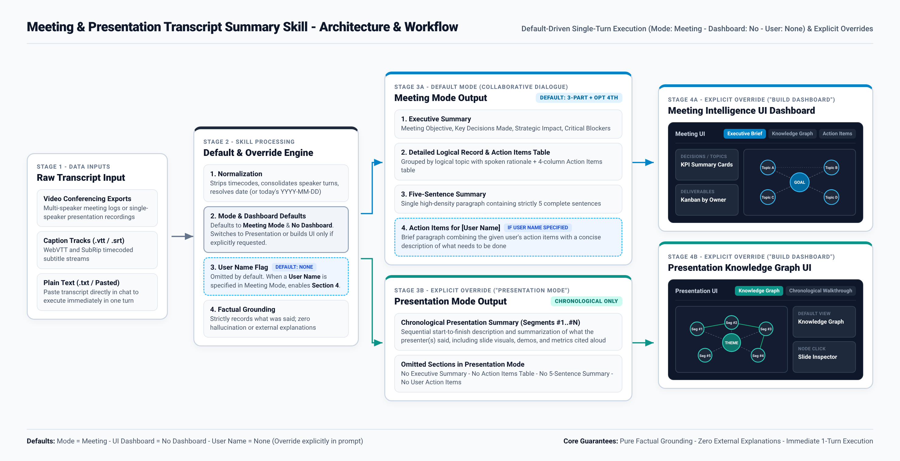
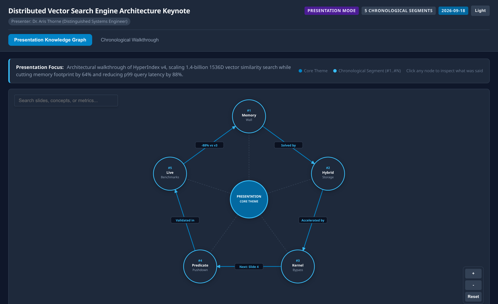

# Meeting and Presentation Transcript Summary Skill

A standardized instruction and template skill for turning raw meeting or presentation transcripts into concise, structured, factually grounded summaries and optional interactive HTML dashboards.

---

## Overview

Raw meeting and presentation transcripts are difficult to scan quickly, and generic summaries often either omit concrete decisions and numbers or expand into verbose play-by-play narration ("David said... Sarah noted...") that is longer than the transcript itself. Collaborative meetings and single-speaker presentations also require different output structures.

The `meeting-transcript-summary` skill handles both formats in a single step. Paste or attach a transcript and it executes immediately using four defaults that you can override directly in your prompt:

| Parameter | Default Value | Default Behavior (When Omitted) | How to Override in Your Prompt |
| :--- | :--- | :--- | :--- |
| **1. Processing Mode** | **`meeting`** (`Meeting Mode`) | Runs **Meeting Mode** (2 core sections: Executive Summary + Detailed Discussion Record & Action Items). | Explicitly specify presentation mode (e.g., `"presentation mode"`, `"mode: presentation"`). |
| **2. Interactive Dashboard** | **`no dashboard`** (Summary only) | Outputs the Markdown summary only; skips `dashboard.html`. | Explicitly request a dashboard (e.g., `"yes dashboard"`, `"build dashboard"`, `"with dashboard"`). |
| **3. Five-Sentence Summary** | **`no`** (Omitted) | Omits the 5-sentence summary unless requested. | Explicitly ask in Meeting Mode (e.g., `"with 5 short sentence summary"`, `"include 5-sentence summary"`, `"add 5 sentence summary"`). |
| **4. User Action Plan** | **`none`** (Omitted) | Omits individual user action items unless requested. | Specify a participant name in Meeting Mode (e.g., `"for Marcus Vance"`, `"action plan for Marcus"`, `"user: Sarah Lin"`). |

### Mode 1: Meeting Mode (`meeting mode` - Default)
Used automatically whenever Presentation Mode is not requested. Designed for multi-participant meetings with discussion, trade-offs, decisions, and assigned follow-ups. By default, **only Sections 1 and 2 are generated**:
1. **Executive Summary (`<= 120 words` ceiling; scaled down on brief transcripts):** High-level overview readable in under 30 seconds -- a 1-sentence meeting objective plus 1-line bullets for key decisions, quantified outcomes, and critical blockers.
2. **Detailed Discussion Record and Action Items:** Bullet-first record grouped by logical topic (`Key Points`, conditional `Trade-offs & Rationale`, and a 1-line `Decision / Status`) preserving every concrete number, technical specification, and decision without speaker-turn narration, followed by a 4-column Action Items table.
3. **Five-Sentence Summary (Optional - Default: `no`; Created Only When User Asks):** Strictly five short, complete sentences (`<= 18 words/sentence`, `<= 85 words` total) summarizing scope, core problem, main decision, impact, and timeline -- appended as `## 3. Five-Sentence Summary` only when requested.
4. **Action Items for [User Name] (Optional - Default: `none`; Created Only When User Asks):** A brief paragraph (`<= 75 words`) listing the specific tasks, deliverables, and deadlines assigned to a requested participant -- appended as `## 3. Action Items for [User Name]` (or `## 4.` when the Five-Sentence Summary is also requested) only when a user name is provided.
5. **Interactive Meeting Web Dashboard (Optional - Default: `no dashboard`; Built Only When Requested):** A standalone 4-tab HTML file (`Executive Brief`, `Interactive Relationship Node Map`, `Action Items`, and `Discussion Record`) saved to `dashboard.html` when requested.

### Mode 2: Presentation Mode (`presentation mode` - Explicit Override Only)
Activated only when `"presentation mode"` (or equivalent) is specified in the prompt. Designed for keynotes, talks, lectures, webinars, town halls, and product demonstrations where one or more speakers present sequentially:
1. **Chronological Presentation Summary Only:** Outputs the presentation header (`Title`, `Date`, `Presenter(s)`) followed strictly by numbered sequential sections (`### 1. [Segment Title]`, `### 2. [Segment Title]`, ...) with 3-5 factual bullets per segment and inline slide references.
2. **Strict Omission of Meeting Sections:** Omits the Executive Summary, Action Items table, Five-Sentence Summary, and User-Specific Action Items section.
3. **Presentation Relationship Map Dashboard (Optional - Default: `no dashboard`):** A standalone 2-tab HTML file opening directly to the `Interactive Relationship Node Map` paired with a `Chronological Walkthrough` tab.

Both modes strictly stay shorter than the source transcript, eliminate speaker-turn narration, never invent facts, and avoid inserting outside explanations not spoken in the transcript.



---

## Repository Structure

All project files use relative paths from the repository root:

```text
meeting-transcript-summary-skill/
|-- SKILL.md                                        # Core skill instruction specification for both modes
|-- DESIGN.md                                       # Dashboard layout, typography, theme, and color specification
|-- prd.md                                          # Product Requirements Document
|-- README.md                                       # User guide, specifications, and integration documentation
|-- LICENSE                                         # Apache 2.0 License
|-- dashboard.html                                  # Top-level working interactive Meeting Mode dashboard
|-- assets/
|   |-- skill_workflow_diagram.png                  # System workflow diagram covering both modes
|   |-- user_interaction_diagram.png                # Execution parameters and optional add-on sections flow diagram
|   |-- dashboard_executive_brief.png               # Meeting Mode Executive Brief view
|   |-- dashboard_knowledge_graph.png               # Meeting Mode Relationship Node Map view
|   |-- dashboard_action_items.png                  # Meeting Mode Action Items view
|   `-- dashboard_presentation_knowledge_graph.png  # Presentation Mode Relationship Node Map view
|-- templates/
|   |-- meeting_dashboard_template.html             # Self-contained 4-tab Meeting Mode dashboard template
|   `-- presentation_dashboard_template.html        # Self-contained 2-tab Presentation Mode dashboard template
|-- references/
|   |-- dashboard_ui_guide.md                       # Dashboard architecture and JSON data schemas for both modes
|   |-- transcript_formats.md                       # Supported caption/transcript formats and parsing rules
|   `-- quality_checklist.md                        # Output verification checklist for both modes
|-- examples/
|   |-- sample_meeting_transcript.txt               # Synthetic multi-participant meeting transcript
|   |-- sample_output_summary.md                    # Default 2-section reference output for Meeting Mode
|   |-- sample_meeting_dashboard.html               # Working interactive dashboard example for Meeting Mode
|   |-- sample_presentation_transcript.txt          # Synthetic single-presenter keynote transcript
|   |-- sample_presentation_summary.md              # Reference chronological output for Presentation Mode
|   `-- sample_presentation_dashboard.html          # Working interactive dashboard example for Presentation Mode
`-- scripts/
    `-- clean_transcript.py                         # Standalone Python CLI utility to strip caption timestamps
```

---

## User Guide: How to Use This Skill (No Coding Required)

You do not need any programming or command-line experience to use this skill. Paste your meeting or presentation transcript into your assistant chat window and the summary generates immediately in one step.

### Step 1: Copy or Download Your Transcript

Save or copy the transcript text from your video call recording, webinar tool, or caption export. Any of these formats work directly:
- Text copied and pasted straight into chat
- Plain text files (`.txt`)
- Subtitle or closed-caption exports (`.vtt` or `.srt`)

### Step 2: Paste the Transcript With a Plain-English Request

The skill starts immediately using four defaults: **Meeting Mode**, **Summary Only (No Dashboard)**, **No 5-Sentence Summary**, and **No Individual User Action Plan**. By default, you receive only the **Executive Summary** and **Detailed Discussion Record and Action Items**. If you want the 5-short-sentence summary, a personal action plan, Presentation Mode, or a visual dashboard, just ask in plain English in the same message.


### Real-World Examples

#### Example 1: Weekly Team Planning Meeting (Default 2-Section Summary)
Best when you want a lean, fast read of decisions, key discussion points, and who owns each follow-up without extra recap paragraphs.

```text
Use the meeting-transcript-summary skill on this transcript:

Maya Patel (9:02 AM): Let's lock in the Q3 customer newsletter launch. Design needs final copy by August 10.
Carlos Rivera (9:04 AM): Our open rate dropped from 28% to 21% last quarter because the digest had nine articles. Cutting it to three focused stories should improve click-through.
Maya Patel (9:06 AM): Agreed, let's cap each issue at three stories. Carlos, draft the August copy by August 8, and Dana will handle final proofreading by August 10.
```

**What you get:** A concise **2-part summary** (strictly shorter than the transcript; the 5-sentence summary and individual user action plan are omitted by default):
1. **Executive Summary** with the meeting goal, the 3-story cap decision, and key numbers (`28%` to `21%`).
2. **Detailed Discussion Record and Action Items** listing Carlos Rivera (draft copy by Aug 8) and Dana (proofread by Aug 10) in a structured table.

#### Example 2: Asking for a 5-Short-Sentence Summary (Quick Email or Slack Recap)
Best when you want the standard Executive Summary and Detailed Discussion Record **plus** a tight paragraph of 5 short sentences you can drop straight into an email or team chat channel.

```text
Use the meeting-transcript-summary skill on this transcript and include a 5 short sentence summary:

[Paste or attach your meeting transcript]
```

You can also combine the 5-short-sentence summary request with a user's action plan in one prompt:

```text
Use the meeting-transcript-summary skill on the attached architecture_review.txt with a 5 short sentence summary and action items for Marcus Vance.
```

**What you get:**
- For the first prompt: `1. Executive Summary`, `2. Detailed Discussion Record and Action Items`, **plus** `## 3. Five-Sentence Summary` (strictly five short, complete sentences, `<= 18 words` each).
- For the combined prompt: Sections `1` and `2`, `## 3. Five-Sentence Summary`, **and** `## 4. Action Items for Marcus Vance`.

#### Example 3: Getting Your Own Action Plan From a Client Call
Best when you attended a client onboarding or project check-in and want a short paragraph at the end listing only what *you* need to deliver (without generating the 5-sentence summary).

```text
Use the meeting-transcript-summary skill on the attached client_kickoff_transcript.txt for Dana Kim.
```

**What you get:** The default 2-part meeting summary (`1. Executive Summary` and `2. Detailed Discussion Record and Action Items`) **plus** `## 3. Action Items for Dana Kim` containing a single brief paragraph combining Dana's assigned deliverables and due dates.

#### Example 4: Building an Interactive Visual Dashboard for a Project Review
Best when you want to filter tasks by owner, export tasks to CSV for a spreadsheet, or share a visual summary in a web browser.

```text
Use the meeting-transcript-summary skill on the attached operations_review.vtt, build dashboard.
```

**What you get:** The default 2-section Markdown summary plus a self-contained `dashboard.html` file you can open directly in any web browser (with `Executive Brief`, `Interactive Relationship Node Map`, filterable `Action Items`, and `Discussion Record` tabs, plus a `Light` / `Dark` theme switch).

#### Example 5: Summarizing a Company Town Hall, Training Webinar, or Lecture
Best when one or more speakers present slides from start to finish without meeting action items.

```text
Use the meeting-transcript-summary skill in presentation mode on this transcript:

[Paste or attach your webinar or town hall transcript]
```

**What you get:** A start-to-finish chronological bullet summary organized by slide or presentation segment, without irrelevant meeting sections or fabricated tasks. Add `, build dashboard` to also generate an interactive slide-by-slide relationship map in `dashboard.html`.

#### Example 6: Ready-to-Copy Raw Text for Wikis or Documents
If you want to paste clean Markdown into a team wiki or shared document repository, request dual output:

```text
Use the meeting-transcript-summary skill on the attached budget_sync.txt. Provide dual output with both rendered markdown and a raw markdown code block.
```

### Step 3: Share or Reuse the Summary

- **Email and Word Processors:** Highlight and copy the formatted summary from chat; headings, bullet lists, and tables paste cleanly into email or document editors.
- **Spreadsheets and Project Trackers:** When you generate `dashboard.html`, open the **Action Items** tab and click **Export CSV** or **Export Markdown** to move tasks directly into a spreadsheet or task board.

---

## Integration and Command-Line Setup

### 1. Workspace Skill Registration

1. Copy the skill directory into your workspace skills directory (for example, `.agents/skills/meeting-transcript-summary/` relative to the workspace root).
2. Invoke the skill with a transcript file path or pasted text:
   ```text
   # Default execution (Meeting Mode, 2 core sections only: Executive Summary + Detailed Discussion & Action Items)
   Use the meeting-transcript-summary skill on examples/sample_meeting_transcript.txt

   # With optional 5-short-sentence summary
   Use the meeting-transcript-summary skill on examples/sample_meeting_transcript.txt with a 5 short sentence summary

   # With optional user action plan only (omits 5-sentence summary)
   Use the meeting-transcript-summary skill on examples/sample_meeting_transcript.txt for Marcus Vance

   # With interactive dashboard, 5-short-sentence summary, and user action plan for Marcus Vance
   Use the meeting-transcript-summary skill on examples/sample_meeting_transcript.txt, build dashboard, with 5 short sentence summary, for Marcus Vance

   # Presentation Mode (chronological summary only, no dashboard)
   Use the meeting-transcript-summary skill in presentation mode on examples/sample_presentation_transcript.txt
   ```

### 2. Web Assistant Configuration

1. Open your assistant's custom instructions or skills panel.
2. Create a skill named `meeting-transcript-summary`.
3. Paste the contents of [SKILL.md](SKILL.md) into the instruction body.
4. Optionally attach [references/transcript_formats.md](references/transcript_formats.md), [references/dashboard_ui_guide.md](references/dashboard_ui_guide.md), [references/quality_checklist.md](references/quality_checklist.md), and [DESIGN.md](DESIGN.md) as reference files.

### 3. Command-Line Transcript Preprocessing

Use [scripts/clean_transcript.py](scripts/clean_transcript.py) to strip WebVTT or SRT cue numbers and timestamps before passing a transcript into a CLI workflow:

```bash
# 1. Normalize raw WebVTT or SRT files into consolidated speaker blocks
python3 scripts/clean_transcript.py raw_recording.vtt --output cleaned_transcript.txt

# 2A. Default Execution: Meeting Mode (2 core sections only, no 5-sentence summary, no user action plan, no dashboard)
cat cleaned_transcript.txt | agent-cli --prompt "Execute meeting-transcript-summary"

# 2B. Meeting Mode + Optional 5-Short-Sentence Summary (adds Section 3: Five-Sentence Summary)
cat cleaned_transcript.txt | agent-cli --prompt "Execute meeting-transcript-summary with 5 short sentence summary"

# 2C. Meeting Mode + Optional User Action Plan Only (adds Section 3: Action Items for Marcus Vance)
cat cleaned_transcript.txt | agent-cli --prompt "Execute meeting-transcript-summary for Marcus Vance"

# 2D. Meeting Mode + 5-Short-Sentence Summary + User Action Plan + Dashboard (4 sections + writes dashboard.html)
cat cleaned_transcript.txt | agent-cli --prompt "Execute meeting-transcript-summary, include 5 short sentence summary, for Marcus Vance, build dashboard"

# 2E. Presentation Mode Override (chronological summary only)
cat cleaned_transcript.txt | agent-cli --prompt "Execute meeting-transcript-summary in presentation mode"

# 2F. Presentation Mode Override + Dashboard (chronological summary + writes dashboard.html)
cat cleaned_transcript.txt | agent-cli --prompt "Execute meeting-transcript-summary in presentation mode, build dashboard"
```

---

## Detailed Output Specifications

### Mode 1: Meeting Mode (`meeting mode`)

#### 1. Executive Summary (`<= 120 words` Ceiling, Scannable in <30s)
- **Meeting Objective:** 1 direct sentence (`<= 25 words`) defining the primary goal.
- **Key Decisions Made:** Max 3-5 direct 1-line bullets (`<= 18 words/bullet`; 1-2 bullets on brief `< 400`-word transcripts) of approved choices.
- **Strategic Outcomes and Impact:** Max 2-4 direct 1-line bullets (`<= 18 words/bullet`) citing explicit metrics, savings, or operational impacts.
- **Critical Risks and Blockers:** Max 2-4 direct 1-line bullets (`<= 18 words/bullet`) of unresolved dependencies or gates (`None stated` if none).

#### 2. Detailed Discussion Record and Action Items
- **Logical Topic Organization:** Groups dialogue by subject matter rather than chronological speaker turns (consolidating into a single topic block on brief single-topic meetings).
- **Key Points (Bullet-First, Fact-First):** 2-5 direct factual bullets per topic (`<= 22 words/bullet`; 1-3 bullets on brief `< 400`-word transcripts) preserving every spec, benchmark, number, and constraint without speaker-turn narration or external explanations.
- **Trade-offs & Rationale (Conditional):** Included only when alternatives were weighed or debated (1-3 bullets or 1 tight line explaining why Option A beat Option B).
- **Decision / Status:** 1 concise line (`<= 18 words`) stating the final agreement or open status.
- **Action Items Table:** Four aligned columns with concise, verb-first cells (`<= 15 words/cell`):
  - `Action Item`: Concrete task description.
  - `Assigned To`: Designated owner name or `Unassigned` if not stated.
  - `Deadline`: Stated date, milestone, or `Not Specified`.
  - `Acceptance Criteria / Target Deliverable`: Specific artifact, sign-off, or outcome required (without repeating the task column).

#### Optional Section: Five-Sentence Summary (Default: `no` - Created Only When User Asks)
- Omitted by default. Generated as `## 3. Five-Sentence Summary` **only** when explicitly requested in the prompt (e.g., `"with 5 short sentence summary"`, `"include 5-sentence summary"`, `"add 5 sentence summary"`).
- Strictly 5 short, complete sentences in a single paragraph (`<= 18 words/sentence`, `<= 85 words` total) summarizing scope, core problem, primary decision, secondary requirement/impact, and immediate timeline.

#### Optional Section: Action Items for [User Name] (Default: `none` - Created Only When User Name Is Specified)
- Omitted by default. Generated **only** when a user name is provided in the prompt (numbered `## 3. Action Items for [User Name]` when the Five-Sentence Summary is omitted, or `## 4. Action Items for [User Name]` when both optional sections are requested).
- Single brief paragraph (`<= 75 words`, 1-3 sentences) combining the user's assigned tasks, concrete deliverables, and deadlines (or one factual sentence if zero tasks were assigned).

---

### Mode 2: Presentation Mode (`presentation mode`)

#### Chronological Presentation Summary
- **Header Metadata:** Presentation Title (`# Presentation Summary: [Title]`), Date (`YYYY-MM-DD`), and `Presenter(s)`.
- **Strict Start-to-Finish Chronological Order:** Segments the transcript into sequential numbered sections (`### 1. [Segment Title]`, `### 2. [Segment Title]`, ...) matching the exact chronological order presented.
- **Direct Chronological Bullets:** 3-5 fact-dense bullets per segment (`<= 22 words/bullet`) capturing technical details, metrics, inline slide/visual citations (e.g., `(Slide 1 chart)`), demo steps, and takeaways -- omitting per-segment `Presenter:` lines for single-presenter talks and avoiding `"presenter explained/noted"` framing.
- **Omitted Sections:** Excludes Executive Summary, Action Items table, Five-Sentence Summary, and User-Specific Action Items section.

---

## Interactive Web Dashboards (Tailored by Mode)

By default, no dashboard is built (`dashboard = no dashboard`). Only when explicitly requested in the prompt (e.g., `"yes dashboard"`, `"build dashboard"`, `"create dashboard"`, `"with dashboard"`), a standalone offline-capable HTML/CSS/JavaScript file is written to `dashboard.html` in accordance with [DESIGN.md](DESIGN.md).

### 1. Meeting Mode Dashboard ([templates/meeting_dashboard_template.html](templates/meeting_dashboard_template.html))
Four tabs designed for multi-participant meetings:
- **Executive Brief:** Displays monospaced KPI counts, SVG benchmark comparison chart, topic-by-owner coverage heatmap, and a flat 2x2 summary grid.
  
- **Interactive Relationship Node Map:** SVG node-link topology connecting the core meeting goal to discussed topics with directed relationship edges (`Enforces`, `Requires`, `Gates`) and a slide-out Detail Inspector drawer.
  
- **Action Items:** View toggle (`Monospace Table` | `Owner Lanes`), live search, owner dropdown filter, and CSV/Markdown export buttons.
  
- **Discussion Record:** Collapsible topic rows containing the structured discussion record.

### 2. Presentation Mode Dashboard ([templates/presentation_dashboard_template.html](templates/presentation_dashboard_template.html))
Tailored for presentations where conceptual structure and chronological progression matter most:
- **Interactive Relationship Node Map (Default Active Tab on Load):**
  - Connects the central `CORE THEME` node to chronological segment nodes labeled with sequence badges (`#1`, `#2`, `#3`, ...) and short titles.
  - Displays sequential progression edges (`Next: Slide 4`, `Solved by`) and conceptual links (`Accelerated by`, `Validated in`).
  - Clicking any node opens the **Slide / Segment Detail Inspector Drawer** showing **What Was Presented & Said**, **Slide Visuals, Demos & Metrics Cited**, and **Stated Key Takeaway**.
- **Chronological Walkthrough (Tab 2):**
  - Sequential numbered timeline accordions (`#01` through `#0N`) with Expand All / Collapse All controls and one-click Markdown export.
- **Omitted Meeting Views:** Excludes Executive Brief metrics and Action Items tabs.



### Templates, Specifications, and Reference Guides
- Design Specification: [DESIGN.md](DESIGN.md)
- Product Requirements Document: [prd.md](prd.md)
- Meeting Mode Template: [templates/meeting_dashboard_template.html](templates/meeting_dashboard_template.html)
- Presentation Mode Template: [templates/presentation_dashboard_template.html](templates/presentation_dashboard_template.html)
- Working Meeting Dashboard Example: [examples/sample_meeting_dashboard.html](examples/sample_meeting_dashboard.html)
- Working Presentation Dashboard Example: [examples/sample_presentation_dashboard.html](examples/sample_presentation_dashboard.html)
- UI Architecture Guide: [references/dashboard_ui_guide.md](references/dashboard_ui_guide.md)

---

## Core Rules and Constraints

- **Anti-Bloat Compression Guardrails (Never Longer Than Source):** Generated summaries (measured in **total words**, including headings and table cells) are strictly shorter than the cleaned source transcript (`<= 65%` with proportional scaling for `< 400`-word brief transcripts; **35%-55%** target and `<= 65%` default ceiling / `< 75%` with optional sections / `<= 60%` Presentation ceiling for `400-1,500`-word transcripts; **25%-45%** / `<= 50%` for `1,500-3,000` words; **10%-25%** and generally `<= 1,100-1,400` words for long sessions) while keeping 100% of concrete metrics, technical specs, decisions, and action items.
- **Fact-First Synthesis (Zero "He Said / She Said" Narration):** Discussion and presentation bullets report facts, architecture, trade-offs, and decisions directly without speaker-turn narration (*"David said..."*, *"Dr. Thorne explained..."*). Personal names appear strictly in headers, Action Items `Assigned To` / optional `Action Items for [User Name]`, multi-presenter transitions, or material sign-off gates/unresolved disagreements.
- **Zero Cross-Section Duplication:** Technical details and rationale appear once in Section 2 rather than repeating across the Executive Summary, topic sub-blocks, and Action Items deliverable cells.
- **Default-Driven Single-Turn Execution (`Mode = meeting`, `Dashboard = no dashboard`, `5-Sentence Summary = no`, `User Action Plan = none`):** When invoked with a transcript, execution runs immediately in one turn without prompting for mode, dashboard preference, 5-sentence summary preference, or user name.
- **Pure Factual Grounding (Zero Hallucination):** Output contains strictly facts, decisions, numbers, slide descriptions, and arguments stated in the source transcript.
- **No External Explanations:** Reports exclusively what speakers articulated during the session without adding external definitions or tutorials.
- **Zero Extrapolation:** Unstated owners or deadlines in Meeting Mode are recorded explicitly as `Unassigned` or `Not Specified`; unstated transcript dates default to the current date (`YYYY-MM-DD`).

---

## Quality Audit and Examples

Generated outputs are verified against [references/quality_checklist.md](references/quality_checklist.md) and [DESIGN.md](DESIGN.md). Complete synthetic reference inputs, summaries, and interactive dashboards for both modes are available in `examples/`:

### Meeting Mode Examples
- Input Transcript: [examples/sample_meeting_transcript.txt](examples/sample_meeting_transcript.txt)
- Default 2-Section Output Summary: [examples/sample_output_summary.md](examples/sample_output_summary.md)
- Interactive Meeting Dashboard: [examples/sample_meeting_dashboard.html](examples/sample_meeting_dashboard.html)

### Presentation Mode Examples
- Input Presentation Transcript: [examples/sample_presentation_transcript.txt](examples/sample_presentation_transcript.txt)
- Chronological Output Summary: [examples/sample_presentation_summary.md](examples/sample_presentation_summary.md)
- Interactive Presentation Dashboard: [examples/sample_presentation_dashboard.html](examples/sample_presentation_dashboard.html)

---

## License

This project is licensed under the Apache License, Version 2.0. See the [LICENSE](LICENSE) file for details.
